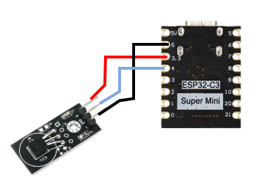
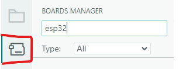

# Đọc nhiệt độ bằng DS18B20 thông qua Esp32 C3

Đây là thư viện hỗ trợ sử dụng cảm biến DS18B20 đọc nhiệt độ môi trường. Esp32 được sử dụng để lấy dữ liệu và hiển thị đồ thị nhiệt độ lên trang web.

Thư viện này có phụ thuộc vào các thư viện sau:

- DallasTemperature - [link](https://github.com/milesburton/Arduino-Temperature-Control-Library) và OneWire - [link](https://www.pjrc.com/teensy/td_libs_OneWire.html): dùng để đọc dữ liệu OneWire từ cảm biến.
- EspAsyncWebserver - [link](https://github.com/ESP32Async/ESPAsyncWebServer) và Async TCP - [link](https://github.com/ESP32Async/AsyncTCP): dùng để cấu hình Esp32 thành 1 server gửi trang web đến client.

Các thư viện trên đều có thể cài đặt qua link hoặc cài đặt qua Arduino IDE.

---

## Mục lục

1. [Các công cụ được sử dụng](#1-các-công-cụ-được-sử-dụng)
2. [Cài đặt các công cụ liên quan](#2-cài-đặt-các-công-cụ-liên-quan)
3. [Chạy example](#3-chạy-example)

### 1. Các công cụ được sử dụng

#### a) Phần cứng

- Esp32 - C3 Supermini
- DS18B20
- Cáp usb Type C

#### b) Phần mềm

- Arduino IDE 2.3.10
- Trình duyệt web (Chrome, Cốc Cốc, ...)

### 2. Cài đặt các công cụ liên quan

- Sơ đồ kết nối phần cứng:
  

- Cài đặt Arduino IDE tại link: [link](https://downloads.arduino.cc/arduino-ide/arduino-ide_2.3.10_Windows_64bit.exe)
- Mở IDE, nhấn vào board manager, gõ esp32 và tải esp32 by Espressif
  
- Nhấn vào library manager, lần lượt gõ OneWire, DallasTemperature, Async TCP, EspAsyncWebserver và tải các thư viện tương ứng.
  

### 3. Chạy example

- Tải thư viện này dưới dạng file .zip, giải nén và mở example/example.ino
- Kết nối theo sơ đồ tại mục 2 và kết nối esp32 với máy tính qua usb
- Vào tools -> board -> esp32 c3 dev module, sau đó tại cửa sổ tools, chọn port -> chọn cổng mà esp32 đang kết nối
- Nhấn ctrl + u, chờ 1 lúc cho đến khi thấy dòng thông báo done uploading
- Chờ khoảng 10 giây, sau đó mở kết nối wifi trên máy tính và kết nối với mạng wifi tên ESP32_Nhietdo
- Chờ đến khi kết nối thành công (hiển thị connected), mở trình duyệt, nhập 192.168.4.1, nhấn enter và chờ đến khi trang web hiển thị thông tin nhiệt độ và biểu đồ, có thể cuộn chuột xuống để xem lịch sử đo
